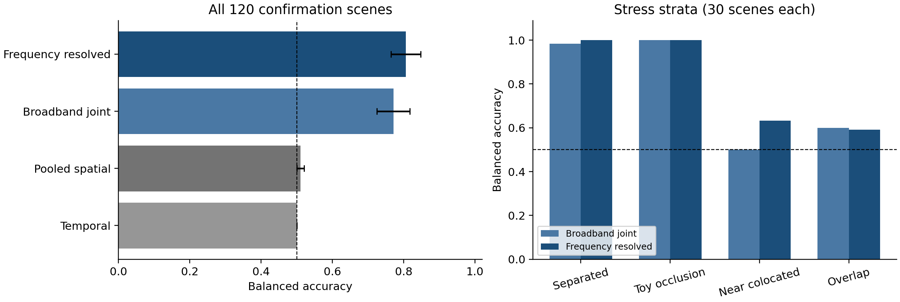

# EventOwner

**An exact-marginal pilot of audio-visual source ownership**  
Saurav K. Aryal, Howard University · November 1, 2026

EventOwner tests whether a joint diagnostic can associate each sound with the correct visible source when global timing and the inventory of events remain unchanged. Two source-event schedules drive actual rotating RGB pixels and four-channel audio. Crossing the two video assignments with the two audio assignments gives four pairs per scene. Each exact video and each exact waveform occurs once under each label, so an audio-only or video-only classifier has exactly 50% balanced accuracy on the complete construction.

The current paper and code report a controlled procedural feasibility study. They do not establish realistic fan acoustics, learned audio generation, or real-world causal attribution.

## Confirmation results

The frozen confirmation contains **120 scenes and 480 dependent crossed pairs** in three held-out procedural blade/layout families. Thresholds were chosen on 60 development scenes before the confirmation run. Intervals resample whole scenes, preserving their four pairs.

| Diagnostic | Balanced accuracy | Scene bootstrap 95% interval | Paired ranking accuracy |
|---|---:|---:|---:|
| Temporal synchrony | 0.5000 | [0.5000, 0.5000] | 0.4917 |
| Pooled spatial coverage | 0.5104 | [0.5000, 0.5208] | 0.5583 |
| Broadband joint | 0.7708 | [0.7250, 0.8167] | 0.9958 |
| Frequency-resolved joint | **0.8063** | [0.7646, 0.8479] | 0.9958 |

The frequency-resolved-minus-broadband balanced-accuracy interval is [0.0063, 0.0646]. Both joint diagnostics rank pairs equally well, so the threshold result does not establish a generally better architecture. Cross-scene shuffled balanced accuracy is 0.5000 for the frequency-resolved method and 0.5063 for broadband.

Difficulty matters: frequency-resolved accuracy is 1.0000 for separated sources, 1.0000 under the toy partial occluder, 0.6333 for near-colocated sources, and 0.5917 for overlapping activity. The latter two remain unresolved. Toy occlusion success is not real occlusion robustness.



## Exploratory real-data component

An additional check decodes 72 four-second windows from nine previously exposed STARSS23 development-training recordings. Matched-versus-shuffled ranking is 0.6250 for the frequency-resolved method (room interval [0.4861, 0.7500]), versus 0.7778 for the simpler pooled-spatial method. This is inconclusive for the proposed diagnostic and does not establish transfer or real source ownership. Real shuffling changes content as well as correspondence, unlike the exact synthetic crossings. All outcomes and recording hashes are retained; raw recordings are retrieved separately under their upstream terms.

## Verify the saved results

Python 3.12 or newer is recommended. This path needs no media downloads, model weights, API key, or cloud service:

```sh
python3 -m venv .venv
.venv/bin/python -m pip install -r requirements.txt
.venv/bin/python verify_saved_results.py
```

The verifier checks the frozen code/protocol/threshold hashes, all 480 marginal balances, every saved score-derived metric and 2,000 scene-bootstrap intervals. It also regenerates and scores the two published lossless samples, checks the real-component arithmetic, and evaluates the small non-vacuity counterexample. This is reproducibility checking, not additional independent experimental evidence.

## Reproduce the procedural study

```sh
bash run_eventowner.sh
```

The launcher creates a fresh timestamped `reproductions/` folder, installs dependencies in `.venv`, runs development, freezes the protocol and thresholds, and executes one confirmation. It refuses to overwrite an existing output. Set `PYTHON=/path/to/python3` or `OUTPUT=reproductions/my-run` to override defaults. All reported original results remain unchanged.

On the original 128 GB host, confirmation took about 51 seconds and the process peaked near 196 MiB. That is a CPU measurement on the actual host, not an exact benchmark on a 48 GB laptop. Generated media take substantially more disk space than the compact numeric release.

To regenerate the numerical figure:

```sh
.venv/bin/python -m pip install -r requirements-figures.txt
.venv/bin/python generate_figures.py
```

`python reproduce_real.py --help` describes optional real-recording replay. It requires FFmpeg and a separately obtained source tree containing the exact STARSS23 audio/video files identified by recording ID and SHA-256. No raw real recordings or participant photographs are included.

## Files and provenance

- `paper.pdf` and `overleaf.zip`: current ACM single-column manuscript; the ZIP contains `draft.tex`, `refs.bib`, `references.bib`, and `figures/`. Standalone TeX/bibliography files are not tracked.
- `pilots/repair09/event_owner.py`: original frozen renderer and diagnostics, byte-identical to the confirmation source.
- `reproduce.py` and `run_eventowner.sh`: portable orchestration around the frozen implementation.
- `runs/repair09-eventowner-v2/`: frozen protocol/thresholds, development/confirmation scores, exact media hashes, states, and real-component results.
- `runs/repair09-eventowner-v1/`: preserved development attempt with a systematic onset-order shortcut; no v1 confirmation was run.
- `examples/`: illustrative MP4 and two lossless hard-stratum scenes. All scenes can be regenerated from the stored state.
- `audits/eventowner/`: numerical/media replay records and the proposed-loss non-vacuity check.
- `PUBLICATION_PROVENANCE.json`: release file hashes and transformations.

The scorer receives decoded pixels and waveforms. Source IDs, geometry, activation schedules, boxes, labels, and seeds are used for rendering or grading only. Known common-rig camera/FOA conventions are shared across spatial methods. Independent unknown sensor mounting is outside the experiment.

## Next research step

The next study will compare a compact coupled residual sound-texture generator with the identical generator trained using the same counterfactual examples without an additional source-intervention term. Changing source A at fixed physical identity will hold source B, room geometry, timbre, and coupled noise fixed. The objective must require the intended response from A while penalizing unintended changes to B. A hard independent-source generator is a mandatory comparator: if it matches quality, coherence, and cost, the simpler model should be preferred. These learned effects and any real transfer are future work, not results of this pilot.

## Historical PoseSplit component

The repository URL is retained for continuity. [The October 31 PoseSplit paper and Overleaf package](archive/posesplit_20261031/) concern audio-plus-known-pose viewport prediction and remain separate from EventOwner. Their frozen code/data remain under `pilots/renewed09/` and `runs/renewed-09-posesplit-20261031/`. Replay them with `python verify_posesplit_results.py`; the legacy launcher is `run_posesplit_legacy.command` and additionally needs its original dependencies. The earlier preprint submission concerns PoseSplit; this new EventOwner manuscript is a distinct repository version.

## Citation and licensing

See `CITATION.cff` for the current artifact and `ATTRIBUTION.txt` for upstream sources. New project code and procedural media are MIT-licensed. STARSS23 metadata/recordings retain their own notice. No pretrained generator weights are redistributed. Any future PhysWave comparison must retain its noncommercial checkpoint/output terms; it cannot silently become an unrestricted release asset.

Repository: https://github.com/Saurav-K-Aryal/posesplit-pilot
